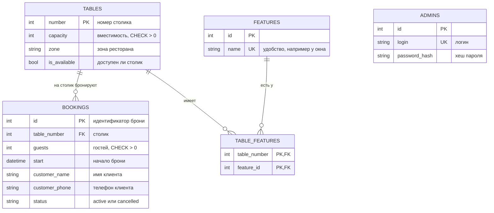

# ER-диаграмма

## Ограничения

- `tables.number`, `bookings.id`, `features.id`, `admins.id` — первичные ключи (PK).
- `bookings.table_number` — внешний ключ на `tables.number`, `ON DELETE RESTRICT`: столик с бронями удалить нельзя (п. 4.2.6 ТЗ).
- `table_features` — связующая таблица для связи «многие ко многим»; при удалении столика или удобства её строки удаляются (`ON DELETE CASCADE`).
- `features.name`, `admins.login` — уникальные (UNIQUE).
- `tables.capacity > 0`, `bookings.guests > 0` — проверки (CHECK).
- `bookings.status` принимает только `active` или `cancelled`.
